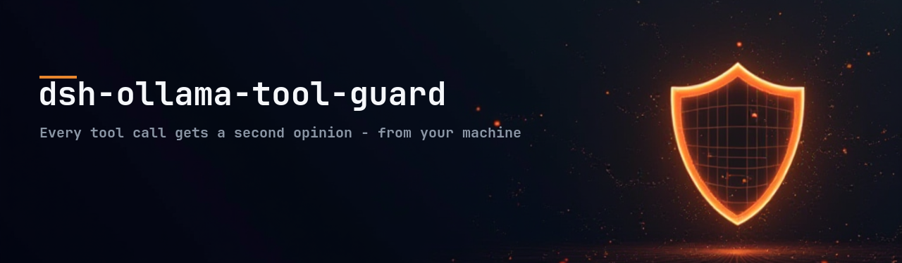
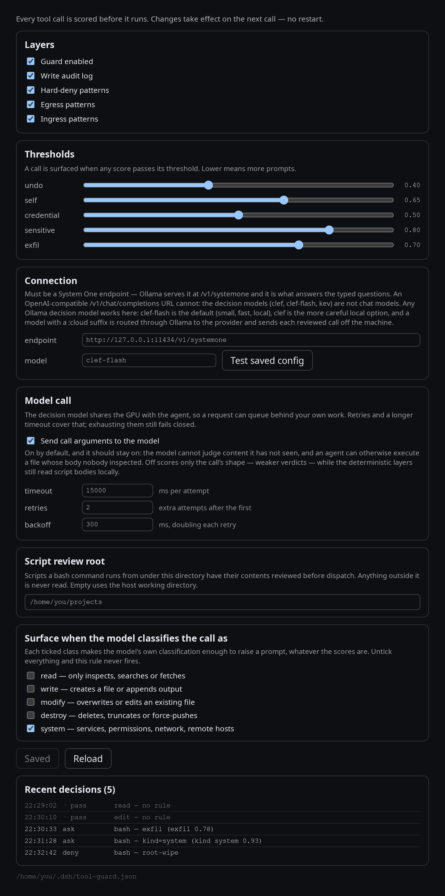

# dsh-ollama-tool-guard



[](https://www.npmjs.com/package/dsh-ollama-tool-guard)
[](https://github.com/Yersi88/dsh-ollama-tool-guard/actions/workflows/ci.yml)
[](LICENSE)

**A second opinion on every tool call your DeepSeek Harness agent makes — from a model running on your own machine.**

Your agent can read any file, run any command and fetch any URL the sandbox allows. This plugin puts a small local model in front of each call. Ordinary ones pass silently. Risky ones come back to you as an approval prompt that says what the model thinks the call does and whether it acts inside or outside your workspace.

If the model cannot be reached, nothing runs. The guard fails closed rather than letting calls slip past unreviewed.

## Requirements

- DeepSeek Harness 0.2.x
- [Ollama](https://ollama.com) 0.35.1 or newer (0.40.6+ if you use a `:cloud` model) — this uses its System One decision API
- About 6 GB of disk for the default model

## Install

**1. Pull the model** (once, ~6 GB):

```
ollama pull clef-flash
```

**2. Install the plugin:**

```
dsh plugin --profile web add dsh-ollama-tool-guard
```

**3. Restart `dsh web`.**

**4. Open Settings → Plugins → Tool guard.**

If the plugin does not appear under Settings, add `"dsh-ollama-tool-guard"` to `dsh.profile.bundles` in `~/.dsh/profiles/web/package.json` and restart again — installing the package and registering it as a bundle are two separate steps.

## What you will see

When a call is surfaced, the prompt reads like a sentence:

```
tool-guard · DELETING · outside workspace · hard to undo · bash · rm -rf /srv/data
```

Left to right: what the model believes the call does (`READING`, `WRITING`, `MODIFYING`, `DELETING`, `SYSTEM CHANGE`), whether it acts inside or outside your workspace, why it was flagged in plain words, then the tool and a short summary. Approve to run it, reject to block it. Nothing runs while the prompt is open.

Everything is adjustable while the harness runs — **Settings → Plugins → Tool Guard**. Changes apply to the next call, no restart:



## Choosing a model

The judge is whatever your own Ollama serves. Any decision model works; these three are the ones this was built against:

| `model` | Runs on | Size | What leaves your machine |
|---|---|---|---|
| `clef-flash` *(default)* | your GPU | 9B, ~6 GB | nothing — fast enough for a per-call gate |
| `clef` | your GPU | 27B, ~18–20 GB | nothing — the more careful local option |
| `clef:cloud` | Ollama's provider | — | each reviewed call |

Change it in **Settings → Plugins → Tool guard → Connection**. The **Test saved config** button sends one probe question and reports the latency, or exactly what went wrong.

## What leaves your machine

With the default local model: nothing. Every review is a request to your own Ollama, so command lines, file contents and URLs stay on the box. A `:cloud` tag sends each reviewed call to the provider instead.

The audit log records what was decided, never the text of the call. See [SECURITY.md](SECURITY.md) for the full picture, including the gaps.

## Where things live

| | |
|---|---|
| Config | `~/.dsh/tool-guard.json` — re-read on every call, so edits apply immediately |
| Audit log | `~/.dsh/tool-guard-audit.jsonl` — one line per call |
| Settings | **Settings → Plugins → Tool guard** — model, endpoint, thresholds, effect classes, test button |

## If something goes wrong

| Symptom | Cause and fix |
|---|---|
| Every tool call is denied | The guard cannot reach its model. Check `ollama list` has the model pulled, and that the endpoint in Settings is right. The denial message names the model and the fix. |
| `the user rejected tool "…"` and you were never asked | The session has no approval surface — a delegated or headless run, or prompts disabled. Use `skip` or `enabled: false` for unattended work. |
| Prompts on things you find harmless | Raise the matching threshold, or untick the effect class in Settings. The prompt tells you which rule fired. |
| Plugin code changes do not apply | The host caches modules. Restart `dsh web`. |

## Learn more

- [SECURITY.md](SECURITY.md) — what it does and does not protect, and what leaves the machine
- [ARCHITECTURE.md](ARCHITECTURE.md) — the layers, the questions it asks, how the thresholds were set
- [CONTRIBUTING.md](CONTRIBUTING.md) — development, tests and releasing

## License

MIT — see [LICENSE](LICENSE).
